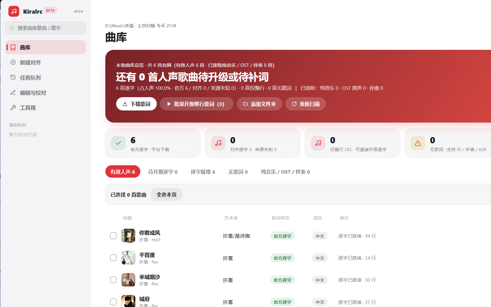
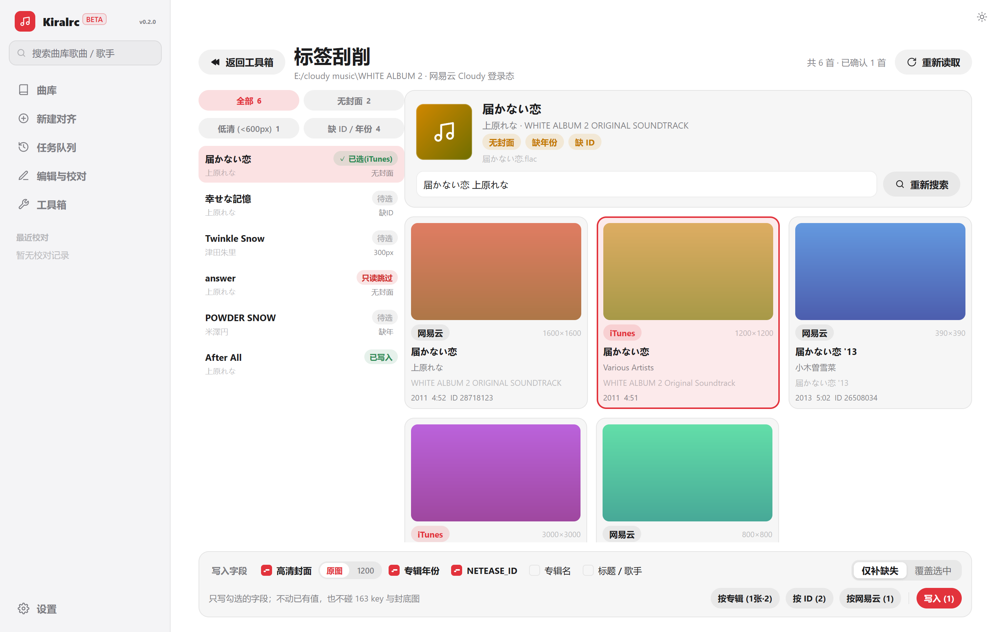
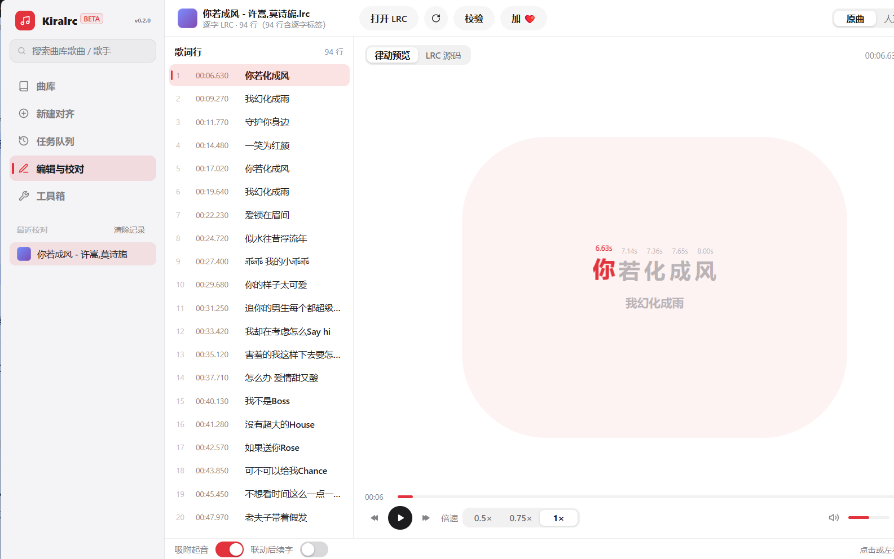

<div align="center">

# Kiralrc

**面向本地音乐曲库的逐字（Enhanced LRC）歌词补全与标签管理工具**

[](https://github.com/kato-megumi-0923/Kiralrc/releases)
[](#快速开始)
[](LICENSE)

核心思路是 **「能直下官方逐字就不算本地模型」**——绝大多数歌曲**无需显卡、无需下载本地模型**，开箱直下官方逐字与译文，<br/>
一站式打通 **NCM 解密 → 曲库管理 → 官方取词 & 译文补全 → 标签刮削 → 校对 & AI 翻译**（冷门曲再由本地歌声模型兜底）。

</div>

---

<p align="center">
  
  
</p>
<p align="center">
  
</p>

## 为什么做 Kiralrc？

整理本地无损曲库时，往往卡在四个痛点上：
1. **网易云 NCM 解密后丢 ID**：只转了音频格式，后续搜歌词、补封面还得靠文件名盲猜；
2. **盲目跑模型费时费显卡**：明明平台本身就有现成的官方逐字词与高清封面，却被一锅端扔进模型重算；
3. **标签残缺 / 封面低清**：缺少 `NETEASE_ID`、专辑年份或高清封面，批量刮削又怕猜错版本把原标签写坏；
4. **冷门曲 / 外语歌体验差**：极少数平台无逐字的特典/翻唱需要精准人声对齐，冷门外语歌还常缺自然流畅的中文译文。

Kiralrc 用一条轻重分明的工作流解决这四个问题：

```text
  ① NCM 解密留 ID  ──▶  ② 直下官方逐字 & 跨源补译文  ──▶  ③ 标签刮削补封面  ──▶  ④ 波形校对 & AI 翻译
  还原标签/封面/ID       网易云/QQ/AMLL/酷狗（免模型）      网易云/iTunes 双栏比对    拖拽微调 · 一键补译文
                                                                                           │
                                                     （可选进阶：全网无逐字的极少数冷门曲）──┴──▶  本地歌声模型兜底
```

---

## 核心功能（无需显卡与本地模型）

### 1. 优先直下平台官方逐字 & 外语译文跨源补全
- 优先解析音频内嵌的网易云 `163 key` 与 `NETEASE_ID` 标签，绕过模糊搜索直连原曲。
- 按 **网易云（YRC）→ QQ 音乐（QRC）→ AMLL（TTML）→ 酷狗（KRC）** 顺序批量补全官方逐字歌词与双语译文；已有对齐版时用官方逐字直接覆盖（不留备份）。
- 支持**外语译文跨源补全**：按语种文字体系精准识别双语译文对，自动检测缺失译文行并跨源拉取补齐。

### 2. 本地曲库总览 & 轻量流畅
- 原生读取 FLAC / MP3 内嵌标签与专辑封面，自动识别歌手与歌名，不再受限于文件命名格式。
- 自动统计歌词覆盖率，精准区分 **官方逐字 / 对齐逐字 / 仅整行 / 无歌词**，并自动排除纯音乐、OST 原声与伴奏轨。
- **曲库分段加载 & 封面 LRU**：按页读取（每页 50 / 100 条可切），上千首也不卡首屏；封面按需解码并做 **400 张固定容量 LRU**（约 26MB），翻页不重复读盘，也不会把位图囤满内存。

### 3. 标签刮削 & 高清封面补全
- **双栏工作台**：左栏按「全部 / 无封面 / 低清 / 缺 ID·年份」筛选，右栏并排展示网易云与 iTunes 候选封面（标出实测原图分辨率），手动挑准版本。
- **三条批量补全路径**：支持**按专辑**（同一张专辑只查一次曲目表、封面只下一次，版本/时长唯一匹配才写）、**按 ID**（已有 `NETEASE_ID` 直接补全）与**按网易云**（歌名+歌手+专辑严格匹配）。
- **增量安全写入**：只改勾选项，原标签对象上增量写入（保留 `163 key` / `REPLAYGAIN` / 封底图）；封面不降级（比本地小不写）；遇限速自动冷却并从当前曲目/专辑续跑。

### 4. 可视化校对台 & AI 整首翻译
- **沉浸式校对台**：黑胶封面律动预览、逐字时间块直接拖拽微调、`±50ms` 整体偏移、LRC 源码直编（开启本地模型后还可对照原曲/人声双波形并一键定位异常行）。
- **AI 整首翻译**：面向缺译文的外语歌，支持 OpenAI 兼容接口（内置 DeepSeek、OpenAI、Gemini、硅基流动、智谱 GLM、通义千问、OpenRouter、本地 Ollama 预设），整首结合上下文翻译并严格对齐行数；API Key 在 Windows 上经 **DPAPI 加密存储**。

### 5. 实用工具箱
- **NCM 无损解密**：还原 MP3 / FLAC，完整写回歌名、歌手、专辑、封面与 `NETEASE_ID`（QQ 的 `.qmc` / `.mflac` / `.mgg` 暂不支持，会明确提示）。
- **LRC 格式批处理**：逐字 LRC 规范校验、双语译文行一键加 ❤️、两位/三位小数时间戳批量转换。
- **安全清理歌词文件**：按格式勾选（`.lrc` / `.vtt` / `.ttml` / `.srt` / `.ass` / `.ssa` / `.txt`），**默认只移入回收站**——回收站报错或取消时未处理文件原样保留；**永久删除是独立二次确认入口**。删完自动刷新曲库状态。

---

## 快速开始

### 系统要求
- **操作系统**：Windows 10 / 11 (x64)
- **日常使用（官方取词 / 译文补全 / 标签刮削 / NCM 解密 / 校对与 AI 翻译）**：**普通核显电脑即可流畅运行，无需显卡，无需下载本地模型**。

### 方式一：下载便携版（推荐）
1. 前往 [Releases](https://github.com/kato-megumi-0923/Kiralrc/releases) 下载 `kiralrc-gui-v0.2.0-windows-amd64.zip` 并解压。
2. 双击运行 `kiralrc-gui.exe`。
3. 首次启动会自动检测本机 Python 环境（依赖齐全时零下载直接复用）；若需初始化依赖，前往 **「设置 → 模型与运行环境」** 点击 **「一键安装/补全运行环境」** 即可。**日常取词与刮削不需要点击「下载基础模型」。**

### 方式二：从源码运行
需要 **Go 1.27+** 与 **Python 3.10 ~ 3.13**：

```bash
# 1. 安装 Python 依赖（仅日常取词/解密/刮削无需 CUDA 版 PyTorch）
pip install faster-whisper demucs transformers pypinyin fugashi unidic-lite pykakasi av numpy pyyaml numba mutagen scipy soundfile onnxruntime

# 2. 编译并启动桌面端 GUI
go build -ldflags="-H windowsgui" -o kiralrc-gui.exe .
./kiralrc-gui.exe
```

---

## 可选进阶：极少数冷门曲的本地模型兜底

如果曲库里有少数特典曲、Live 版或翻唱在各平台都找不到逐字歌词，或者需要使用独立人声分离，可以在 **「设置 → 模型与运行环境」** 按需点击 **「一键下载基础模型」**（或运行 `python scripts/fetch_models.py`）启用本地对齐：

- **硬件建议**：开启本地模型推荐 **NVIDIA 显卡（CUDA，≥6GB 显存）**，安装 CUDA 版 PyTorch（`pip install torch torchaudio --index-url https://download.pytorch.org/whl/cu124`），并预留约 **6~8GB** 磁盘空间存放模型权重；无独显也可回退 CPU 运行（速度较慢）。
- **人声分离 + 分语种歌声强制对齐**：先用 `demucs (htdemucs)` 分离纯净人声轨（内置 1–4kHz 主唱检测自动跳过无人声轨），再按语种调用专门的歌声对齐模型：

| 语种 | 默认对齐模型 | 特色处理 |
| :--- | :--- | :--- |
| **中文 (`zh`)** | **HubertFA v0.0.7**（ONNX，可选回退 SOFA） | `pypinyin` + `polyphone.toml` 多音字自定义词表，支持「鬼畜/波形起音优先」模式 |
| **日文 (`ja`)** | **NextFire MMS**（日语歌声模型） | `fugashi`（MeCab / UniDic）精确语境读音，自动处理助词读音与长拖腔 |
| **英文 (`en`) 及多语** | **Echora-300M MMS**（多语歌词专精模型） | 24s 长滑窗上下文 + 人声能量包络长音保真，支持按词 / 按字母粒度切换 |

- **独立人声分离页**：实时进度条、分离出人声与伴奏双轨、自动标出首次起声点、支持页内试听并导出为 **FLAC / WAV / MP3**。
- **极端冷门无词兜底**：支持在曲库内 **批量填写网易云 ID**、**手动粘贴/导入参考词**，或启用 **本地 ASR 人声听写兜底**（`faster-whisper-large-v3` / 中文 `FireRedASR-AED-L`）。

---

## 输出格式与播放器兼容性

Kiralrc 统一输出标准的 **Enhanced LRC（增强型逐字 LRC）**：

```lrc
[ti:示例曲目]
[ar:示例歌手]
[by:HubertFA 歌声对齐]
[kiralrc:aligned]
[00:06.232]<00:06.232>走<00:07.115>在<00:07.440>乡<00:07.820>间<00:08.510>
```

- 统一 **UTF-8 无 BOM**、**三位小数时间戳**（`mm:ss.SSS`），且每行末尾自带**闭合结束标签**（防止播放器在末字起唱瞬间提前切字）。
- **完美支持**：椒盐音乐（Salt Player）、Foobar2000 逐字插件、MusicFree、Oto Music、Cloudy 等支持 Enhanced LRC 的本地播放器。
- **不兼容提示**：网易云音乐官方 App 的本地歌词解析器仅支持传统整行 LRC，不支持 `<mm:ss.xxx>` 行内标签，直接导入会把尖括号时间戳原样显示在屏幕上。

---

## 进阶说明与命令行用法

<details>
<summary><b>点击展开：为什么不用纯 Whisper / WhisperX 做逐字对齐？</b></summary>

本机实测对比：

| 方案 | 实测表现 |
| :--- | :--- |
| faster-whisper 词级时间 + 均摊 | 同音字误识多，且歌声行首普遍 **偏早 0.5 ~ 1.2 秒** |
| WhisperX（wav2vec2 语音 CTC） | 短音尚可，但 **长拖腔被严重压扁**（实测 5.27s 拖腔被压成 2.47s） |
| **HubertFA / SOFA（中文歌声专精）** | 专为歌声训练，长音准确、句内节奏自然，与人声起音差 < 0.1s |
| **NextFire / Echora MMS（日/英/多语歌声）** | 针对歌声与歌词微调，配合 24s 长滑窗与人声能量包络保真长音 |

> 另：切勿拿网易云官方整行 LRC 当对齐校验基准——它常对应另一版母带（前导静音差 0.5~1s）。Kiralrc 统一以**本地音频分离出的人声轨能量包络**为准。

</details>

<details>
<summary><b>点击展开：命令行（CLI）常用指令</b></summary>

```bash
# 批量下载官方逐字歌词（网易云 → QQ → AMLL → 酷狗，不跑模型）
python -m kiralrc download "D:\Music" --jobs 2

# 解密网易云 NCM 音频（保留原标签、封面与 NETEASE_ID）
python -m kiralrc decrypt "D:\Music"

# 单曲音频 → 逐字 LRC（中文默认 HubertFA；日文 --lang ja，英文 --lang en）
python -m kiralrc align "歌曲.flac" --ti 曲名 --ar 歌手

# 独立人声分离（产物保存在 work/sep/，不污染曲库）
python -m kiralrc separate "歌曲.flac"

# 格式校验 / 双语译文加 ❤️ / 两位转三位小数 / 环境自检
python -m kiralrc validate "歌曲.lrc"
python -m kiralrc hearts "歌曲.lrc"
python -m kiralrc convert "歌曲.lrc"
python -m kiralrc info
```

切换中文对齐器为 SOFA：在 `config.toml` 的 `[defaults]` 中将 `zh_aligner` 设为 `"sofa"`，并运行 `python scripts/fetch_models.py --with-sofa`。

</details>

<details>
<summary><b>点击展开：项目结构与开源致谢</b></summary>

```text
main.go            Windows 桌面端 GUI 入口
internal/app/      Go 桌面端界面、曲库/刮削/任务队列、音频播放器、DPAPI 安全存储与 AI 翻译
kiralrc/           Python 核心包（官方取词、NCM 解密、HubertFA/SOFA/MMS 对齐、人声分离与校验）
config.toml        路径与默认参数配置
polyphone.toml     中文多音字自定义读音词表
scripts/           模型下载（fetch_models.py）与便携打包（build_release.ps1）
models/            本地模型与 HuggingFace / Torch 统一缓存目录（不提交 Git）
```

**致谢与代码来源**：
- [MyGo](https://github.com/nya-owo/mygo)（MIT）：Go 原生桌面 UI 框架，窗口、绘制、控件与音频输出都由它支撑（`internal/app/` 全部界面代码）。
- [mewkiz/flac](https://github.com/mewkiz/flac)、[hajimehoshi/go-mp3](https://github.com/hajimehoshi/go-mp3)（均为 MIT）：曲库扫描时直读 FLAC / MP3 标签。
- [HubertFA v0.0.7](https://github.com/wolfgitpr/HubertFA)（Apache-2.0）：中文 ONNX 歌声强制对齐核心与推理代码（`kiralrc/_hubertfa/`）。
- [qiuqiao/SOFA](https://github.com/qiuqiao/SOFA)（MIT）：中文拼音词典与可选歌声对齐模型（`third_party/SOFA/`）。
- [NextFire MMS](https://huggingface.co/NextFire/mms-300m-ForcedAligner-karaoke-ja-Latn) & [Echora-300M MMS](https://huggingface.co/hcX02/echora-mms-300m-multilingual-lyrics-forced-aligner)：日/英/多语歌声歌词强制对齐模型。
- [Demucs](https://github.com/facebookresearch/demucs)、[faster-whisper](https://github.com/SYSTRAN/faster-whisper) 与 [amll-ttml-db](https://github.com/amll-dev/amll-ttml-db)。

</details>

<details>
<summary><b>点击展开：版本更新记录</b></summary>

### v0.2.0（2026-11-24）
- **标签刮削（新）**：双栏工作台——左栏按「全部 / 无封面 / 低清 / 缺 ID·年份」筛，右栏并排看网易云与 iTunes 候选，手动挑版本（默认不预选），底栏控制写入字段（默认只补高清封面、专辑年份、`NETEASE_ID`）与策略（仅补缺失 / 覆盖选中）。
- **三条批量路径**：按专辑（专辑 ID 分组，一张专辑查一次、封面下一次，歌名/版本/歌手/时长对得上才写，多条命中留手选）、按 ID（已有 `NETEASE_ID` 直接补全）、按网易云（严格匹配后写入）。
- **写入安全**：只改勾选项、原标签对象上增量写（`163 key` / `REPLAYGAIN` / 封底图都留着）；封面必须能解码且不比本地小才写；限速统一冷却，暂停后从当前曲目/当前专辑自动续跑（可取消，连续三次即停）。
- **曲库分段加载 & 封面 LRU**：曲库按页读取（50 / 100 条可切），封面按需解码并做 400 张固定容量 LRU，翻页与长列表不再越用越吃内存。
- **清理歌词文件更保守**：不再在回收站失败后改走直接删除；没处理的文件原样保留并如实报结果，永久删除独立成第二个入口（二次确认）。
- **设置页重构与外语译文补全增强**：拆分独立设置模块（`internal/app/settings.go`），增强官方逐字下载与外语译文跨源补全。

### v0.2.0-beta（2026-11-23）
- **优先直下官方逐字**：新增 `download` 流程与曲库直下入口，支持按标签 ID（`163 key` / `NETEASE_ID`）及精准匹配从网易云 / QQ / AMLL / 酷狗获取官方逐字歌词。
- **中文默认切换 HubertFA v0.0.7**：ONNX 推理开箱即用，保留 SOFA 作为可选回退。
- **NCM 加密音频解密**：内置解密工具，完整保留封面、元信息与网易云歌曲 ID。
- **独立人声分离页**：支持分离进度展示、人声/伴奏双轨试听、首次起声定位及 FLAC / WAV / MP3 导出。
- **AI 歌词翻译 & DPAPI 加密**：编辑页新增整首 AI 翻译，内置 8 家主流服务商与本地 Ollama 预设，API Key 经 Windows DPAPI 加密存储。
- **清理歌词文件**：新增独立清理页，按扩展名分组统计并勾选，二次确认后批量**移入回收站**；回收站报错或取消时文件原样保留（永久删除是单独的二次确认入口），删完自动重扫曲库。
- **曲库与体验增强**：原生读取 FLAC / MP3 标签与内嵌封面、常驻 Python Worker 复用、便携运行环境一键初始化、人声波形校验点击跳转。

</details>

---

## 许可

本项目原创代码以 [MIT License](LICENSE) 开源。`kiralrc/_hubertfa/` 遵循上游 Apache-2.0 许可，`third_party/SOFA/` 遵循上游 MIT 许可，各模型权重版权归原作者所有。仓库内不包含任何受版权保护的音频或歌词文件。
